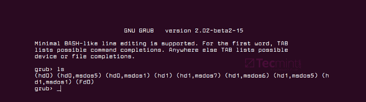

# Заметки о работе с Linux

# Оглавление

1. [Работа с файловой системой](#работа-с-файловой-системой)
   - [Монтирование дисков](#монтирование-дисков)

2. [Настройка системы](#настройка-системы)
   - [Загрузка системы из оболочки GRUB](#загрузка-системы-из-оболочки-grub)
   - [Переустановка/восстановление загрузчика grub](#переустановкавосстановление-загрузчика-grub)
   - [Активация "Quick Search" в synaptic](#активация-quick-search-в-synaptic)
   - [Настройка разрешения второго монитора](#настройка-разрешения-второго-монитора)
   - [Восстановление xorg.conf](#восстановление-xorgconf)
   - [Настройка 5.1 звука в PulseAudio](#настройка-51-звука-в-pulseaudio)
   - [Ручное указание дополнительных DNS серверов](#ручное-указание-дополнительных-dns-серверов)

3. [Исправление ошибок](#исправление-ошибок)
   - [Fix неправильного отображения иконки skype в tray](#fix-неправильного-отображения-иконки-skype-в-tray)

## Работа с файловой системой

### Монтирование дисков

Для того, чтобы примонтировать нужный диск из консоли, нужно выполнить 2
простых действия:

- Посмотреть как ОС определила жесткий диск. Это можно сделать при помощи
  команды

  ```bash
  sudo fdisk -l
  ```

- Теперь, увидев, какое имя присвоила ОС диску, его можно примонтировать к
  нужной дирректории

  ```bash
  sudo mount -t ntfs /dev/sdb1 /media
  ```

  Данная команда примонтирует раздел диска c именем `sdb1` и файловой системой
  `ntfs` к папке `/media`.

Ответ нашел
[здесь](https://askubuntu.com/questions/177825/how-to-mount-an-external-hdd)

## Настройка системы

### Загрузка системы из оболочки GRUB

Для того, чтобы загрузить систему из оболочки GRUB необходимо:

- Найти раздел на котором расположены файлы `vmlinuz` или `linux`, и
  `initrd.img`. Посмотреть список файлов можно при помощи `ls (hd0,1)/`. Если
  на разделе `hd0,1` нет необходимых файлов, то продолжайте поиск на других
  разделах. Для этого увеличивайте цифру расположенную после запятой на единицу
  до тех пор пока не найдете нужный раздел.
- После того как файлы найдены необходимо выполнить

  ```
  # Загружаем ядро
  linux (hd0,1)/vmlinuz root=/dev/sda1
  или
  linux (hd0,1)/linux root=/dev/sda1
  ```

  ```
  # Загружаем initrd-образ
  initrd (hd0,1)/initrd.img
  boot
  ```

  P.S. если вы нашли файлы не в `hd0,1`, то укажите в командах актуальный для
  вас раздел. Например если вы нашли файлы в `hd0,2`, то вам нужно выполнять:

  ```
  linux (hd0,2)/vmlinuz root=/dev/sda2
  initrd (hd0,2)/initrd.img
  boot
  ```

Полезные ссылки:

- [How do I boot my PC from GRUB?](https://askubuntu.com/questions/929833/how-do-i-boot-my-pc-from-grub)
- [GRUB - загрузчик системы](https://help.ubuntu.ru/wiki/grub)

### Переустановка/восстановление загрузчика grub

Иногда бывает, что после установки системы компьютер не загружается, а на экане
красуется окно загрузчика grub.



Есть 2 основных способа исправить данную ситуацию:

- восстановление Grub в rescue mode
- восстановление Grub с помощью утилиты Boot repair

**Восстановление Grub в rescue mode**

Если по каким-то причинам у вас нет доступа к LiveCD/USB-носителю, а также к
компьютеру, с помощью которого этот самый носитель можно было бы сделать, то
этот способ для вас.

Само восстановление проходит таким образом: сначала мы подгружаем все модули,
чтобы открыть доступ ко всей функциональной части Grub, после чего запуститься
с нужного раздела. Надо понимать, что Grub состоит из двух частей:

Одна из этих частей (первая) записана в MBR диска. В ней присутствует базовый
функционал и ничего больше (консоль в rescue mode).

Стало быть, нам нужно определить, в каком разделе находится вторая часть Grub
(находится в каталоге /boot/grub), и после чего подгрузить все недостающие
модули. А вот уже после этого мы сможем запустить загрузчик с нужного раздела.
В rescue mode есть всего четыре команды:

```
ls
set
unset
insmod
```

Для начала вводим следующую команду:

```python
ls
```

В выводе будет что-то подобное:

```
(hd0) (hd0,msdos3) (hd0,msdos2) (hd0,msdos1) (hd1) (hd1,msdos2) (hd1,msdos1)
```

В некоторых случаях Grub неправильно опеределяет файловые системы находящиеся
на разделах дисков. В данном примере загрузчик показывает их как msdos. Мы
должны попытаться угадать диски, которые видим. В примере доступно два диска.
Диск с индексом 0 содержащий три раздела, и диск с индексом 1 содержащий два
раздела. Если вы знаете структуру своих дисков, определить нужный труда не
составит.

В загрузчике Grub разделы нумеруются в обратном исчислении. Не очень ясно какой
именно из разделов назван, к примеру (hd0,msdos3). Чтобы было более понятно,
можно использовать вид (hd0,1). Если в грабе отсчет дисков идет с 0, а разделов
с 1, то можно определить, что операционная система установлена в первый раздел
первого раздела - (hd0,1). Используем следующую команду:

```
set prefix=(hd0,1)/boot/grub
set root=(hd0,1)
```

С помощью этих команд мы приказываем системе использовать какой-то конкретный
диск, для выполнения всех остальных операций (в нашем случае, это диск
(hd0,1)). Чтобы проверить есть ли на данном диске загрузчик, введем эту
команду:

```
ls /boot/grub
```

Если в выводе будет список файлов и папок, значит мы все сделали правильно.
Теперь можно загрузить все необходимые модули. Для этого выполним команды:

```
insmod ext2
insmod normal
normal
```

После выполнения команд Grub загрузится в полнофункциональном режиме. Будут
найдены все операционные системы, которые установлены на компьютере, после чего
будет показано стандартное меню загрузки.

Чтобы закрепить результат (и не проделывать все то же самое после перезапуска
ПК), нужно зайти в терминал своего дистрибутива Linux, где с root правами
выполнить следующую команду:

```bash
grub-install /dev/sdX
```

sdX - диск, на который должен быть установлен Grub. Так же стоит заметить, что
данная команда не всегда помогает исправить ситуацию. В этом случае необходимо
прибегнуть к помощи утилиты Boot repair, которая описывается в этой заметке
отдельно.

Если операционная система расположена на разделе с файловой системой btrfs, то
нам необходимо выполнить следующие команды:

```
set prefix=(hd0,1)/@/boot/grub
set root=(hd0,1)
```

И подгрузить модули:

```
insmod btrfs
insmod normal
```

Ну и теперь запустить GRUB:

```
normal
```

**Восстановление Grub с помощью утилиты Boot repair**

С помощью этой замечательной утилиты вы сможете восстановить загрузчик всего в
пару кликов. Утилита имеет собственный GUI, ее использование не вызовет
трудностей.

Чтобы установить boot repair, вы можете воспользоваться одним из приведенных
способов:

- Запись и установка специального
  [образа диска Boot Repair](http://sourceforge.net/projects/boot-repair-cd/files/)
  (и дальнейшая загрузка с него)
- Установка Boot repair из PPA-репозитория в LiveCD/USB дистрибутиве или в
  системе загруженной вручную из GRUB rescue mode

Если с первым способом все понятно: нужно просто скачать и записать образ с
помощью соответствующих инструментов. То во втором уже нужно знать конкретные
команды, которые выглядят следующим образом:

```bash
sudo add-apt-repository ppa:yannubuntu/boot-repair
sudo apt-get update && sudo apt-get install -y boot-repair
```

В утилите будет доступно два варианта на выбор:

_Recommended repair_ исправляет большую часть известных ошибок, которые могли
бы возникнуть при запуске. С его помощью вы сможете пофиксить и загрузчик Grub.

_Create a BootInfo summary_ создает Boot-Info-Script – скрипт, который
позволяет диагностировать большинство проблем при загрузке.

Здесь же есть и _Advanced options_. Он включает в себя варианты для
восстановления и настройки загрузчика Grub2 (загрузка по-умолчанию, опции
загрузки ядра, отображение или скрытие GRUB при загрузке, удаление GRUB). С
помощью этих же инструментов, вы можете восстановить MBR и т.д.

Вам обязательно стоит заглянуть на
[официальный сайт](http://sourceforge.net/p/boot-repair/home/Home/) Boot
Repair. Там вы сможете найти более подробную информацию обо всех возможностях и
особенностях программы. Там же будет доступна информация о выходе новых версий:
фиксах и улучшениях самой утилиты, а также многом и многом другом.

[Оригинальная статья](https://omgubuntu.ru/nie-zaghruzhaietsia-linux-chinim-zaghruzchik-grub/)

### Активация "Quick Search" в synaptic

Иногда бывает, что по умолчанию "quick search" не активирован в synaptic и это
очень неудобно. Для того, чтобы исправить это, нужно выполнить следующие
команды:

```bash
sudo apt-get install apt-xapian-index
sudo update-apt-xapian-index -vf
```

### Настройка разрешения второго монитора

При подключении 2 монитора я к несчастью обнаружил, что у него выставлено
слишком маленькое разрешение и выставить максимально доступное невозможно. Ниже
я опишу как я ставил систему и как решил эту проблему. Эта проблема возникла
сразу после установки системы, по этому описывать буду с самого начала.

1. Установил систему.
2. Установил через менеджер драйверов последний доступный драйвер для своей
   видеокарты (на момент написания статьи это был nvidia-331) и перезагрузил
   систему.
3. Подключил второй монитор.
4. Создал `xorg.conf` с помощью автоконфигуратора `sudo nvidia-xconfig`
5. Открыл созданный файл `sudo nano /etc/X11/xorg.conf` и в секции `Monitor`
   изменил значения `HorizSync` и `VertRefresh` на такие:

   ```
   HorizSync       31.0 - 81.0
   VertRefresh     56.0 - 76.0
   ```

6. Перезагрузил X Server.
7. Открыл `nvidia-settings` и перешёл в раздел
   `X Server Display Configuration`. Здесь после внесенных изменений у второго
   монитора стало возможно выбрать нужное разрешение экрана. После это можно
   выбрать нужное расположение мониторов, выбрать главный применить эти
   измения, а после сохранить их нажав `Save to X Configuration file`. После
   всех выше перечисленных действий должно все работать как надо. Вот
   содержимое файла `xorg.conf`, после всех действий над ним:

   ```
   Section "ServerLayout"
       Identifier     "Layout0"
       Screen      0  "Screen0" 0 0
       InputDevice    "Keyboard0" "CoreKeyboard"
       InputDevice    "Mouse0" "CorePointer"
       Option         "Xinerama" "0"
   EndSection

   Section "Files"
   EndSection

   Section "InputDevice"

       # generated from default
       Identifier     "Mouse0"
       Driver         "mouse"
       Option         "Protocol" "auto"
       Option         "Device" "/dev/psaux"
       Option         "Emulate3Buttons" "no"
       Option         "ZAxisMapping" "4 5"
   EndSection

   Section "InputDevice"

       # generated from default
       Identifier     "Keyboard0"
       Driver         "kbd"
   EndSection

   Section "Monitor"
       Identifier     "Monitor0"
       VendorName     "Unknown"
       ModelName      "CRT-0"
       HorizSync       31.0 - 81.0
       VertRefresh     56.0 - 76.0
       Option         "DPMS"
   EndSection

   Section "Device"
       Identifier     "Device0"
       Driver         "nvidia"
       VendorName     "NVIDIA Corporation"
       BoardName      "GeForce GTX 560"
   EndSection

   Section "Screen"

   # Removed Option "metamodes" "DVI-I-0: nvidia-auto-select +1920+156, HDMI-0: nvidia-auto-select +0+0"
       Identifier     "Screen0"
       Device         "Device0"
       Monitor        "Monitor0"
       DefaultDepth    24
       Option         "Stereo" "0"
       Option         "nvidiaXineramaInfoOrder" "DFP-1"
       Option         "metamodes" "DVI-I-0: 1280x1024 +1920+28, HDMI-0: nvidia-auto-select +0+0"
       Option         "SLI" "Off"
       Option         "MultiGPU" "Off"
       Option         "BaseMosaic" "off"
       SubSection     "Display"
           Depth       24
       EndSubSection
   EndSection
   ```

**Статьи которые помогли в нахождении решения:**

ubuntu nvidia after reboot monitor off

- http://askubuntu.com/questions/421730/xorg-conf-changes-from-nvidia-setting-have-no-effect-after-reboot
- http://askubuntu.com/questions/456470/cant-save-nvidia-settings-for-screens-after-reboot

Настройка 2 мониторов

- http://unixforum.org/index.php?showtopic=90226

1280x1024 HorizSync и VertRefresh

- http://www.blackmoreops.com/2014/08/29/fix-linux-display-issue-find-horizsync-vertrefresh-rates/
- http://askubuntu.com/questions/60939/how-to-get-1280x1024-with-a-benq-t905

ubuntu модель монитора

- http://igorka.com.ua/2010-03-15/ubuntu-ne-opredelyaet-model-monitora/
- http://igorka.com.ua/2010-02-22/x-server-v-linux/

Изменить разрешение монитора в ubuntu

- http://forums.overclockers.ru/viewtopic.php?t=112768
- http://help.ubuntu.ru/wiki/драйвер_видеокарт_nvidia#неправильно_определяются_разрешение_и_частота_монитора

### Восстановление xorg.conf

Бывают случаи, что в результате редактирования файла `xorg.conf`, Xserver не
запускается, а резервная копия файла не была сделана. В этом случае можно
сгенерировать новый файл с помощью утилиты для настройки Xserver:

```
sudo X -configure
```

После этого в домашней директории появится файл xorg.conf.new. Попробовать
загрузиться использовав настройки этого файла можно вот так:

```
sudo X -config /root/xorg.conf.new
```

Если загрузка Xserver прошла успешно, то можно заменить нерабочий файл этим.
Стоит заметить если у вас используются проприетарные драйвера от Nvidia, то
лучше используйте утилиту от Nvidia. Она сама заменит не работающий файл новым
и вам нужно будет только попробовать перезапустить графический сеанс:

```
sudo nvidia-xconfig
```

### Настройка 5.1 звука в PulseAudio

Настройки PulseAudio находятся в `/etc/pulse/daemon.conf`. Нужно немного
изменить содержание данного файла. Разкоментируем строку:

```
; default-sample-channels = 2
```

В этом файле знаком комментария служит ";". Вместо двойки в этой строке, нужно
указать сколько каналов небходимо использовать. Например если у вас система
5.1, нужно поставить 6, если система 7.1, то соответственно 8. Далее находим
строку:

```
; enable-lfe-remixing = no
```

разкоментируем её и устанавливаем значение не "no", а "yes". Эта строка
отвечает за включение саббуфера. Lfe (low-frequency effects, перевод:
низкочастотные эффекты). Находим строку:

```
; enable-remixing = yes
```

и разкоментируем её. На одном из форумов объясняется этот параметр так: «Любой
звук меньше 5.1 будет растягиваться до 5.1. Настоящий 5.1 будет выводиться
нормально, главное чтоб в плеере был указан вывод 5.1 (vlc, smplayer), а то
сперва произойдет даунмикс плеером до стерео (дефолтная настройка), а потом
пульс растянет до 5.1.»

Дополнительные параметры звукового драйвера ALSA доступны через консольную
утилиту `alsamixer` (чтобы запустить, нужно ввести эту команду в терминале).

### Ручное указание дополнительных DNS серверов

Для того, чтобы иметь возможность вручную указать дополнительные dns севера,
необходимо:

- установить resolvconf

  ```bash
  sudo apt-get install resolvconf
  ```

- открыть файл `/etc/resolvconf/resolv.conf.d/head` и добавить в конец адреса
  нужных dns серверов.

  ```
  nameserver 8.8.8.8
  nameserver 8.8.4.4
  ```

- выполнить в консоли `sudo resolvconf -u`

Использованные материалы:

- [How do I set my DNS when resolv.conf is being overwritten?](https://unix.stackexchange.com/questions/128220/how-do-i-set-my-dns-when-resolv-conf-is-being-overwritten)

## Исправление ошибок

### Fix неправильного отображения иконки skype в tray

В некоторых оболочках значек skype в tray отображается как полтора маленьких
значка. Для того, чтобы это исправить, нужно:

- открыть файл `/usr/bin/skypeforlinux` в текстовом редакторе
- найти в нем строку

  ```
  nohup "$SKYPE_PATH" --executed-from="$(pwd)" --pid=$$ "$@" > "$SKYPE_LOGS/skype-startup.log" 2>&1 &
  ```

- превести ее к следующему виду

  ```
  XDG_CURRENT_DESKTOP=Unity
  nohup "$SKYPE_PATH" --executed-from="$(pwd)" --pid=$$ "$@" > "$SKYPE_LOGS/skype-startup.log" 2>&1 &
  XDG_CURRENT_DESKTOP=MATE
  ```

Ответ нашел [здесь](https://github.com/mate-desktop/mate-panel/issues/793)
