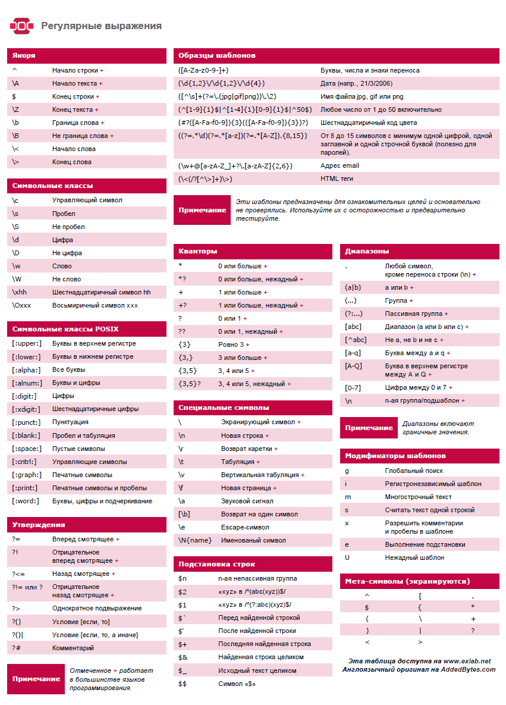

# Регулярные выражения

# Оглавление

1. [Теория](#теория)
   - [Использование групп при замене (частичное изменение текста)](#использование-групп-при-замене-частичное-изменение-текста)
   - [Шпаргалка](#шпаргалка)

2. [Примеры](#примеры)
   - [Поиск текста записанного через тире](#поиск-текста-записанного-через-тире)
   - [Валидация email](#валидация-email)
   - [Удаление повторяющихся слов](#удаление-повторяющихся-слов)

## Теория

### Использование групп при замене (частичное изменение текста)

Иногда бывают ситуации, когда необходимо найти при помощи регулярного выражения
кусок текста и например поменять в нем слова местами или заменить только часть
найденного текста.

Данную задачу можно решить обращаясь к группам регулярных выражений (части
регулярного выражения заключенные в круглые скобки).

К группам можно обращаться 2 способами:

1. через символ доллара $0 - $9 (работает в IDEA)
2. через обратный слеш \0 - \9 (работает в python)

**Обращение через $ (IDEA)**

Важно заметить, что данный синтасис поддержиается не всеми текстовыми
редакторами и языками. Вот простой пример показывающий как добавить слово в
найденное предложение.

Исходный текст:

```
как тебя зовут друг
```

Регулярное выражения для поиска текста:

```regexp
(.*зовут)\s+(друг)
```

Регулярное выражения для замены:

```regexp
$1 дорогой $2
```

В результате замены получим:

```regexp
как тебя зовут дорогой друг
```

**Обращение через косую черту (python)**

```python
>>> import re
>>> data = 'Вася пупкин дурак красавчик'
>>> pattern = '(.*) (дурак) (.*)'
>>> a = re.sub(pattern, r'\1 не \2 \3', data)
>>> a
'Вася пупкин не дурак красавчик'
```

Представленный пример выше пример будет работать если в шаблоне было
использовано меньше 9 групп. Если групп больше 9, то можно ссылаться на них при
помощи конструкции вида `\g<12>`.

Полезные ссылки:

- [Регулярные выражения в Python от простого к сложному. Подробности, примеры, картинки, упражнения](https://habr.com/ru/post/349860/)

### Шпаргалка

Шпаргалка по синтаксису regexp 

## Примеры

### Поиск текста записанного через тире

Условия регулярного выражения:

- текст должен начинаться с большой буквы
- тире может быть только 1 или его не будет сосвсем
- текст должен быть длинной минимум 3 символа, максимум 15

Пример текста:

```
Test-test
```

Решение:

```regexp
^(?=.{3,15}$)[A-Z][a-z]+-?[a-z]+$
```

### Валидация email

Если возникла идея валидировать email при помощи регулярного выражения, то
самый лучший способ это сделать, это проверить, что в строке пристуствует
символ @. Все остальные варианты будут слишком сложными и все равно не будут
покрывать всех возможных вариантов.

Решение:

```regexp
.+@.+
```

Материалы по данной теме:

- [Прекратите проверять Email с помощью регулярных выражений!](https://habr.com/post/175375/)

### Удаление повторяющихся слов

Удаляет повторяющиеся слова:

```python
>>> import re
>>> data = 'Вася Вася пупкин Вася дурак Вася красавчик'
>>> pattern = r'(\b\w+\b\s)(?=.?\1)'
>>> a = re.sub(pattern, '', data)
>>> a
'Вася пупкин Вася дурак Вася красавчик'
```

Удаляет повторяющиеся слова, даже те, что не идут подряд.

Вариант для киррилицы:

```python
>>> import re
>>> data = 'Вася Вася пупкин Вася дурак Вася красавчик'
>>> pattern = r'(\b[а-яА-яёЁ]+\b\s)(?=.*?\1)'
>>> a = re.sub(pattern, '', data)
>>> a
пупкин дурак Вася красавчик
```

Вариант для латиницы:

```regexp
(\b\w+\b\s)(?=.*?\1)
```

[Ссылка](https://zharikov.site/note/regexp_delete_repeatwords.html) на
оригинальную статью.
